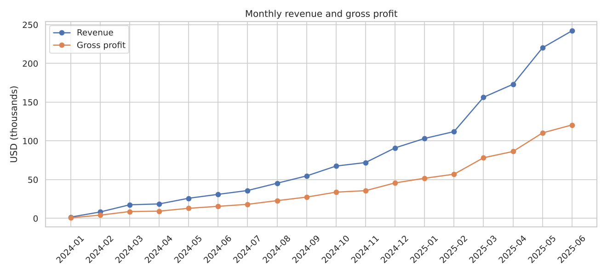
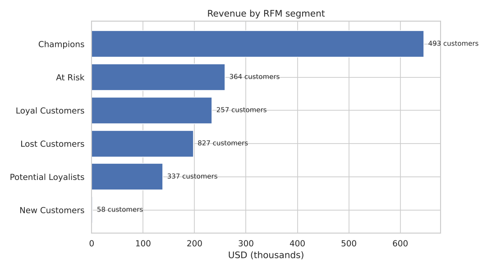
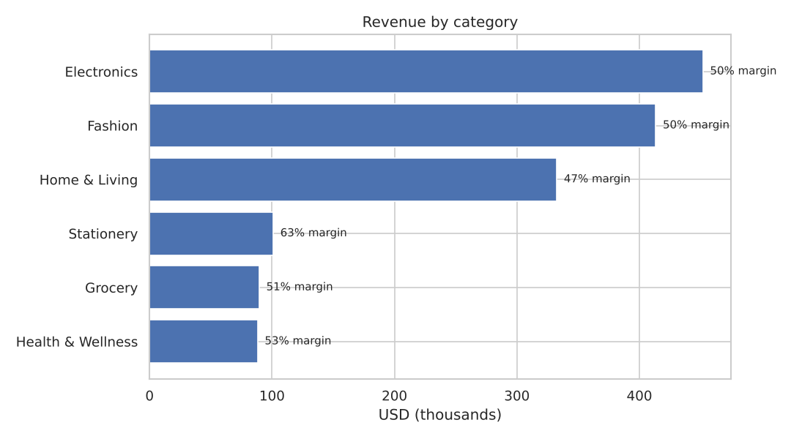
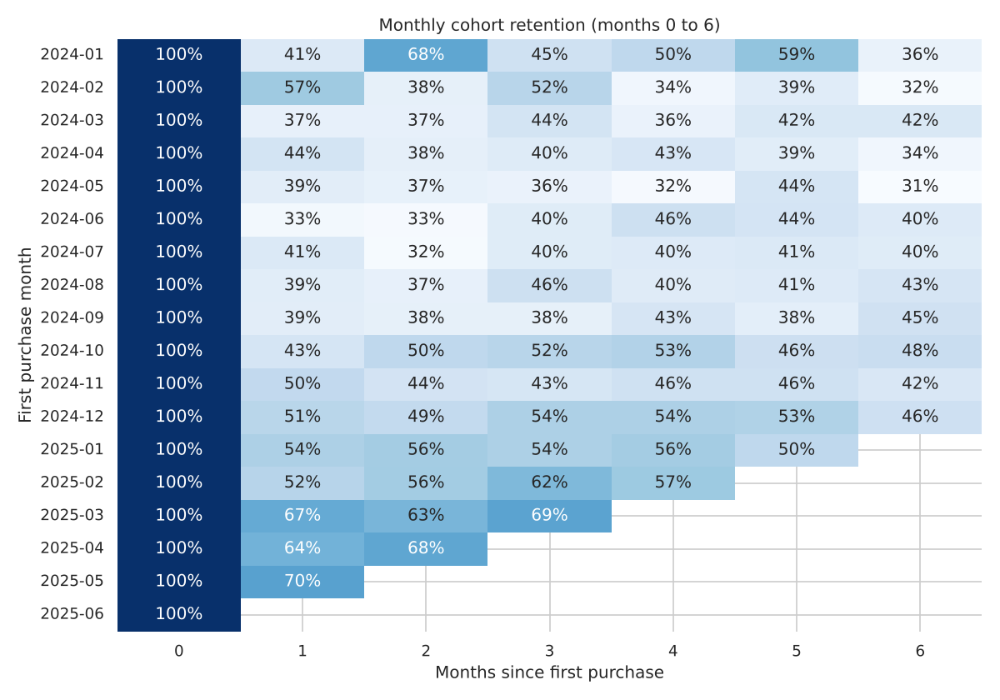
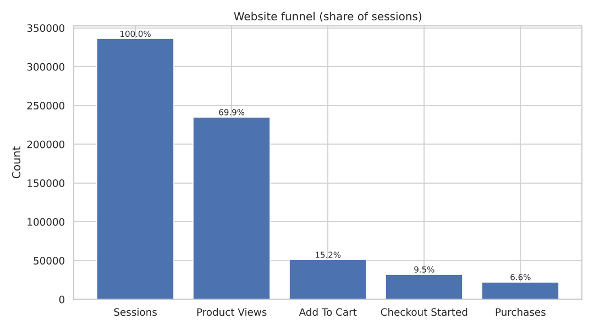

# E-commerce Revenue & Customer Analytics

An end-to-end analytics project on 18 months of e-commerce order and website funnel data. It answers the questions a growth or finance team would ask: what drives profitable revenue, which customers are worth keeping, where shoppers drop out of the funnel, and which products and channels deserve more investment.

**Stack:** Python, Pandas, NumPy, SQL (SQLite), Matplotlib, Seaborn, Jupyter, Power BI-ready CSV exports



## Business problem

The business sells across six categories and six acquisition channels. It wants to know:

- Which categories and products bring in revenue, and which ones quietly lose margin
- How much of revenue depends on repeat customers, and who is at risk of churning
- How well monthly cohorts retain after their first purchase
- Where the website funnel loses the most shoppers
- How much discounting costs

## Dataset

`scripts/generate_dataset.py` creates a reproducible synthetic dataset (fixed seed, no downloads needed):

- 18,000 order lines from January 2024 to June 2025, placed by 2,336 buying customers
- Product, price, cost, discount, payment method, city, state, acquisition channel, signup date and order status
- Weekly funnel data per channel: sessions, product views, add to cart, checkout started, purchases

Cancelled and returned orders (about 10% of lines) are kept for leakage analysis but excluded from realized revenue.

## What the analysis covers

- Revenue, orders, AOV, gross profit and margin by month, category, product, region and channel
- New vs returning customer contribution
- RFM segmentation into Champions, Loyal Customers, Potential Loyalists, New Customers, At Risk and Lost Customers
- 90-day inactivity churn and churn rate by segment
- Monthly cohort retention matrix
- Funnel conversion and drop-off by stage
- Discount impact and low-margin, high-revenue products

## Key findings

From the current run (`outputs/business_insights.md`):

| Finding | Value |
|---|---:|
| Completed revenue | $1.48M |
| Gross margin | 50.1% |
| Average order value | $91.25 |
| Top category | Electronics, $452K |
| Weakest category margin | Home & Living, 46.6% |
| Lowest margin product | Breeze Air Purifier, 39.8% |
| Order lines from returning customers | 85.5% |
| Revenue from Champions segment (21% of customers) | 43.7% |
| 90-day churn rate | 21.4% |
| Avg month-3 cohort retention | 47.6% |
| Session to purchase conversion | 6.6% |
| Checkout drop-off | 30.5% |
| Revenue given away as discounts | $97K |

Affiliate customers bring the highest revenue per customer ($741), while Organic Search brings the lowest ($596). Margins are almost flat across channels (about 50%), so the difference comes from customer value, not pricing.

<p>


</p>
<p>


</p>

## Recommendations

1. Run win-back campaigns for the 364 At Risk customers before they cross the 90-day mark. They still account for 17.6% of revenue.
2. Shift acquisition budget toward Affiliate and Social, which bring more revenue per customer at the same margin.
3. Review pricing and supplier cost for Breeze Air Purifier and the Home & Living category.
4. Use bundles and cross-sells to turn first-time buyers into repeat buyers, since returning customers drive most of the order volume.
5. Focus funnel tests on checkout, where about 3 in 10 shoppers who start checkout do not finish.
6. Replace blanket discounts with segment-specific offers and track the effect on gross profit, not just sales.

## Power BI

`outputs/` holds clean CSVs ready to import. The [dashboard plan](powerbi/dashboard_plan.md) lays out five pages: Executive Overview, Revenue and Product Performance, Customer Analytics, Retention and Churn, and Growth and Acquisition.

## SQL

[`sql/analysis_queries.sql`](sql/analysis_queries.sql) has 10 queries that run against `data/ecommerce.sqlite`: overall KPIs, monthly growth, product and category profitability, new vs returning revenue, purchase frequency and CLV proxy, revenue by geography and channel, Pareto contribution and a 90-day churn proxy.

## Repository structure

```text
ecommerce-analytics/
├── scripts/
│   ├── generate_dataset.py      # synthetic orders and funnel data
│   ├── data_cleaning.py         # cleaning, RFM, churn flags, cohorts
│   ├── export_powerbi_data.py   # KPI tables, SQLite database, insights
│   └── make_charts.py           # PNG charts in outputs/charts
├── notebooks/                   # four executed notebooks
├── sql/                         # schema and analysis queries
├── powerbi/                     # dashboard plan
├── outputs/                     # Power BI CSVs, insights, charts
├── requirements.txt
└── README.md
```

`data/` is created when you run the pipeline and is not committed.

## How to run

From the project root:

```bash
python -m pip install -r requirements.txt
python scripts/generate_dataset.py
python scripts/data_cleaning.py
python scripts/export_powerbi_data.py
python scripts/make_charts.py
```

This creates the raw and cleaned data, `data/ecommerce.sqlite`, the CSVs in `outputs/`, the insights file and the charts. Then open the notebooks with `jupyter notebook notebooks`.

## Limitations

The data is synthetic, so the findings show the method rather than real market behavior. The funnel data is generated separately from the orders, so funnel and order numbers are not reconciled. Churn uses a simple 90-day inactivity rule.
